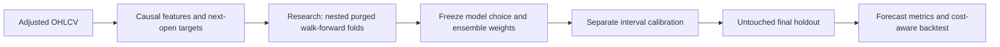

# MarketForge

**A research workbench for finding which stock-return forecasting models survive a fair test.**

MarketForge compares statistical baselines, regularized linear models, tree ensembles, kernel methods, neural networks, a soft regime mixture, and a temporal weighted ensemble. It tunes models using nested chronological validation, freezes the selection before a final holdout, and evaluates an executable next-open strategy after transaction costs.

The aim is evidence, not a predetermined winner. A simple baseline beating a complex model is a useful result. Forecasting accuracy and trading profitability are separate questions.

## Quick start

Python 3.10-3.12 is recommended; the core also supports Python 3.9.

```bash
python3 -m venv .venv
source .venv/bin/activate
python -m pip install -e '.[dev,data]'
marketforge demo --output runs/demo
```

The demo runs without network access and uses **synthetic data**. Open `runs/demo/report.html` for a self-contained report.

For the full model collection:

```bash
python -m pip install -e '.[all]'
marketforge fetch --tickers AAPL MSFT SPY QQQ \
  --start 2016-01-01 --end 2026-11-11 --output data/market.csv
marketforge run --data data/market.csv --config configs/research.yaml --output runs/research
marketforge forecast --data data/market.csv --artifact runs/research/model.joblib \
  --output runs/research/latest_forecasts.csv
```

The end date is exclusive. Yahoo data is a convenience research source; download failures are errors and never silently replaced with synthetic prices. Use a fresh output directory for each experiment. macOS XGBoost may require an OpenMP runtime (`brew install libomp`). A failed optional model is disclosed in the report.

`configs/quick.yaml` runs a smaller preset with no hyperparameter search; `configs/research.yaml` runs the complete nested search including optional neural and boosting models. To select a subset, add `--models zero,ridge,regime_mixture`. The zero-return baseline is always included.

Completed folds and final fits are saved atomically in the run's local `.checkpoints/`
directory. After an interruption, repeat the same command with `--resume`.
Resuming verifies the data, configuration, features, algorithm source, and library
versions before reusing results. A changed experiment requires a fresh output directory.
Checkpoints contain serialized Python objects, so only resume your own trusted runs.
Use `--workers 3` to run independent fits in three separate processes. Worker count
can change when resuming; it does not change the search space or selection rule.

## How the experiment works



- **37 features:** lagged returns, momentum, volatility, intraday ranges, volume, RSI, and contemporaneous cross-sectional ranks. Every transform uses information available at the signal close.
- **Executable labels:** a signal at close `t` forecasts the return from open `t+1` to open `t+1+h`. The simulator supports `h=1`; longer horizons receive predictive diagnostics without a misleading overlapping-return backtest.
- **Purged date groups:** all assets on a forecast date share a fold. Training labels ending at or after the first validation date are removed, with a configurable pre-validation gap.
- **Nested tuning:** hyperparameters use only inner training windows. Development scores come from outer windows; the final holdout never selects the winner.
- **Soft regime experts:** a training-fitted Gaussian mixture gates regularized local experts, with effective-sample-size shrinkage toward a global model.
- **Temporal ensemble:** earlier out-of-fold errors determine nonnegative inverse-MSE weights. The first fold uses equal weights.
- **Separate calibration:** the model remains frozen after research training. A later calibration segment provides residual-based intervals; time dependence means their empirical coverage must be measured.
- **Execution accounting:** next-open timing, volatility-scaled signals, gross exposure limits, turnover costs, and terminal liquidation. No broker integration or live order placement.
- **Uncertainty analysis:** a date-clustered moving-block bootstrap compares final forecast error with the zero-return baseline.

See [methodology](docs/methodology.md), [model details](docs/models.md), and
[runtime and reproducibility notes](docs/runtime.md).

## Models

| Family | Registry names |
|---|---|
| Baselines | `zero`, `historical_mean` |
| Regularized linear | `ridge`, `elastic_net` |
| Tree ensembles | `random_forest`, `extra_trees`, `hist_gradient_boosting` |
| Kernel / neural | `svr`, `mlp` |
| Regime adaptation | `regime_mixture` |
| Optional boosting | `xgboost` |
| Optional PyTorch | `torch_attention`, `torch_residual` |
| Learned combination | `temporal_ensemble` |

The attention model attends over engineered feature tokens. It is not a temporal Transformer or language model. Its lag features encode past observations explicitly.

## Artifacts

Every run writes `summary.json`, `tuning.json`, development and holdout leaderboards, every model's out-of-sample predictions, the selected model's intervals, daily portfolio returns, a portable HTML report, and `model.joblib`. Summaries include date boundaries, data hashes, library versions, model failures, selected parameters, and fit warnings.

The final forecast uses the latest price date, requiring complete features for every ticker in the original training universe. The saved model is deliberately frozen before calibration and holdout; its training date is included in each forecast. Retraining and recalibration require a new experiment. Only load trusted local joblib artifacts, since deserialization executes Python objects.

The committed `data/` snapshot and `results/` experiment document the initial real-data study, including its compressed selected-model checkpoint. Local virtual environments, caches, scratch files, and checkpoints from other runs are excluded from Git; commands reproduce the artifacts.

## CSV contract

Required columns: `date,ticker,open,high,low,close,volume`. Use daily, consistently split/dividend-adjusted OHLC prices. Duplicate dates per asset, missing values, invalid OHLC relationships, negative volume, and nonpositive prices fail validation. Dates are session dates, not arbitrary intraday timestamps.

All selected assets must use the same trading calendar. Validation rejects interior calendar gaps relative to the supplied panel, while allowing different listing start and end dates. The simulator also rejects inconsistent holding intervals. A current list of surviving tickers is not a survivorship-free historical universe. Adjusted historical series can also be revised by the provider; the stored snapshot is not a point-in-time corporate-action archive.

## Development

```bash
python -m pip install -e '.[dev]'
ruff check .
pytest
```

Tests cover chronological boundaries, future-data invariance, target alignment, turnover accounting, estimator reproducibility, and an end-to-end experiment. CI uses synthetic data so checks do not depend on a market-data service.

## Interpretation

The winner is the lowest development out-of-fold RMSE for this fixed universe, horizon, feature set, and period. It is not a universal best stock predictor. Repeatedly inspecting the holdout and redesigning models turns that holdout into development data. Reserve new future observations for subsequent claims.

The simulator omits spread dynamics, market impact, borrow availability/fees, funding, taxes, and market-open fill uncertainty. Reported intervals and backtests are research diagnostics, not a promise of reliable investment returns.

## References

- [Scikit-learn: common pitfalls and data leakage](https://scikit-learn.org/stable/common_pitfalls.html)
- [Scikit-learn: TimeSeriesSplit](https://scikit-learn.org/stable/modules/generated/sklearn.model_selection.TimeSeriesSplit.html)
- [Conformal prediction beyond exchangeability](https://www.stat.cmu.edu/~ryantibs/papers/nexcp.pdf)
- [PyTorch TransformerEncoderLayer](https://docs.pytorch.org/docs/stable/generated/torch.nn.TransformerEncoderLayer.html)
- [yfinance source and usage terms](https://github.com/ranaroussi/yfinance)
